# FinChat — Current-State Audit
## Phase 0: Repository Reconnaissance & Ground-Truth Assessment

> **Audit date:** 2026-10-29  
> **Auditor:** Antigravity (static inspection; no runtime execution performed)  
> **Authoritative source:** Actual source files in `c:\Users\yashv\Desktop\REPOS\investo\`

---

## 1. Executive Summary

FinChat (repository name: **investo**) is a full-stack AI-powered financial intelligence application. It has grown well beyond a simple chatbot. The current implementation consists of:

- A **React 19 / TypeScript / Vite** single-page application with seven distinct feature tabs.
- A **FastAPI (Python 3.11)** backend with nine API endpoints, deployed via Docker to **Hugging Face Spaces**.
- A **dual-vector-store RAG system**: a Pinecone cloud index for a pre-loaded institutional corpus, and an in-memory session store for user-uploaded documents.
- A **multi-provider LLM chain**: a fine-tuned GGUF model served on a separate Hugging Face Space → Groq (cloud, primary fallback) → OpenRouter (secondary fallback).
- A **supplementary backend module** (`agent_engine.py`, `market_tools.py`, `quant_engine.py`, `rag_utils.py`, `schemas.py`) that implements an agentic ReAct loop, live market data via `yfinance`, DCF valuation, Monte Carlo GBM simulation, and a local FAISS vector store — used by the `/api/analyze` endpoint only.
- A **React-only quantitative layer** (QuantLab, CapitalLab) that performs DCF and Monte Carlo calculations entirely in the browser using mock/static data.
- **No database** — all persistent state is in Pinecone (cloud), FAISS files on disk, or browser `localStorage`.
- **No authentication or authorization** of any kind.

The application is deployed at `https://investo-bot-xi.vercel.app/` (frontend on Vercel) and `https://indusyash-coordinator-rag.hf.space` (backend on Hugging Face Spaces).

> [!IMPORTANT]
> The frontend chat panel (`onSendMessage` in `App.tsx`) is **hardwired to a simulated, timeout-based response** and does **not** call the backend `/chat` endpoint. The actual RAG chat logic in `main.py` is only reachable directly via API. This is the single most important disconnect in the codebase.

---

## 2. Current Project Purpose and Expanded Scope

### Stated Purpose
From `index.html` meta tags and UI labels: *"Institutional-grade financial intelligence terminal, quantitative analytics, SEC 10-K RAG, and autonomous valuation engine."*

### Actual Scope (Verified in Code)

| Capability | Where Implemented | Real or Simulated? |
|---|---|---|
| Stock price / fundamentals lookup | `main.py` `/api/stock/{ticker}` | Real — calls Finnhub + Alpha Vantage + Market Stack |
| RAG chat (institutional corpus) | `main.py` `/chat` | Real — Pinecone + SentenceTransformer + Groq/GGUF |
| User document upload & indexing | `main.py` `/api/upload` | Real — pypdf + sentence-transformers in-memory |
| Semantic search sandbox | `main.py` `/api/search` | Real — session store + Pinecone hybrid |
| Agentic analysis (ReAct loop) | `agent_engine.py` via `/api/analyze` | Real code; not called from UI chat box |
| DCF valuation (backend) | `quant_engine.py` + `market_tools.py` | Real — yfinance data + Python math |
| Monte Carlo GBM (backend) | `quant_engine.py` | Real — numpy GBM simulation |
| FAISS local vectorstore | `rag_utils.py` | Real code; only used by `/api/analyze` |
| DCF valuation (frontend QuantLab) | `QuantLab.tsx` | **Simulated** — mock FCF proxy, static volatility |
| Monte Carlo fan chart (frontend) | `QuantLab.tsx` | **Simulated** — hardcoded 1.8% daily vol, 68.4% prob |
| News feed (MarketPulse tab) | `MarketPulse.tsx` | **Simulated** — `MOCK_NEWS` from `mockData.ts` |
| Ticker tape (header) | `TickerTape.tsx` | **Simulated** — hardcoded static prices |
| Watchlist bar | `WatchlistBar.tsx` | Functional — `localStorage` persistence, `STOCK_DATABASE` prices |
| Terminal chat (Dashboard) | `App.tsx` → `handleSendMessage` | **Simulated** — `setTimeout` mock response |
| What-If Calculator | `WhatIfCalculator.tsx` | Partially real — real math, hardcoded historical multipliers |
| Research Memo export | `ResearchMemoModal.tsx` | Functional — clipboard copy, hardcoded DCF assumptions |
| Stock comparison matrix | `StockComparison.tsx` (inferred) | Likely simulated — not fully read but follows mock data pattern |
| Capital Lab (SIP, Loan, FIRE) | `CapitalLab.tsx` | Real — pure-math calculations, no external data |
| CapitalLab policy vs term comparison | `CapitalLab.tsx` | Real — compound interest loop |
| Ticker symbol resolution via LLM | `main.py` (Groq) | Real — uses `llama-3.1-8b-instant` |
| Backend health indicator | `Dashboard.tsx` + `api.ts` | Real — polls local then cloud endpoint |

### Intended Users
Financial learners, individual investors, and students wanting institutional-style analysis tools without paying Bloomberg Terminal prices.

---

## 3. Verified Architecture Diagram

Based only on confirmed code relationships:

```mermaid
flowchart TD
    subgraph Browser["Browser (Vercel — investo-bot-xi.vercel.app)"]
        UI["React 19 SPA\n(Vite + TypeScript)"]
        MOCK["Static Mock Data\nmockData.ts / TickerTape / MarketPulse"]
        LS["localStorage\n(Watchlist)"]
        QF["QuantLab\nDCF + MC in-browser\n(pure math, mock FCF)"]
        CL["CapitalLab\nSIP / Loan / FIRE\n(real math)"]
        API_CLIENT["api.ts\nAPI Bridge Client"]
        UI --> MOCK
        UI --> LS
        UI --> QF
        UI --> CL
        UI --> API_CLIENT
    end

    subgraph HF_COORD["HF Space — indusyash-coordinator-rag.hf.space\n(Docker, Python 3.11, port 7860)"]
        FASTAPI["FastAPI main.py"]
        EMBED["SentenceTransformer\nBAAI/bge-small-en-v1.5 (CPU)"]
        SESSION["SESSION_STORES\n(in-memory dict)"]
        PYPDF["pypdf\nPDF text extractor"]
        FASTAPI --> EMBED
        FASTAPI --> SESSION
        FASTAPI --> PYPDF
    end

    subgraph HF_GGUF["HF Space — indusyash-rag-finetune.hf.space\n(GGUF model server)"]
        GGUF["Fine-tuned Llama 3.2 3B\nGGUF /generate endpoint"]
    end

    subgraph EXT_APIS["External APIs"]
        PINECONE["Pinecone Cloud\nIndex: investo-rag\n(~2,400-page SEC corpus)"]
        FINNHUB["Finnhub\n(live quotes, news, recommendations)"]
        ALPHA["Alpha Vantage\n(fundamentals, daily time series)"]
        MARKETSTACK["Market Stack\n(fallback — name, EOD data)"]
        GROQ["Groq Cloud\nllama-3.1-8b-instant\n(chat + ticker resolution)"]
        OPENROUTER["OpenRouter\nmeta-llama/llama-3-8b-instruct:free\n(final fallback)"]
    end

    API_CLIENT -->|"POST /chat\nPOST /api/upload\nPOST /api/search\nGET /api/stock/:ticker\nGET /api/health"| FASTAPI

    FASTAPI -->|"RAG generation\n(primary)"| GGUF
    FASTAPI -->|"RAG generation\n(1st fallback)\nticker resolution"| GROQ
    FASTAPI -->|"RAG generation\n(2nd fallback)"| OPENROUTER
    FASTAPI -->|"vector search"| PINECONE
    FASTAPI -->|"quote, news,\nrecommendations"| FINNHUB
    FASTAPI -->|"fundamentals,\nchart data"| ALPHA
    FASTAPI -->|"name + EOD\nfallback"| MARKETSTACK

    subgraph AGENT["Agent Engine (analyze only)"]
        AE["agent_engine.py\nFinancialAgentEngine\nReAct loop"]
        MT["market_tools.py\nyfinance quotes/fundamentals"]
        QE["quant_engine.py\nDCF + Monte Carlo (numpy/pandas)"]
        RU["rag_utils.py\nFAISS local vectorstore\nall-MiniLM-L6-v2"]
        SCH["schemas.py\nPydantic models"]
        AE --> MT
        AE --> QE
        AE --> RU
        AE --> SCH
        MT --> QE
    end

    FASTAPI -->|"POST /api/analyze"| AE
    RU -->|"disk persistence"| FAISS_FILE["data/faiss_index/\n(local FAISS files)"]
    MT -->|"live data"| YFINANCE["yfinance\n(Yahoo Finance)"]

    NOTE["⚠️ CRITICAL: Dashboard 'Send' button\nuses simulated setTimeout response,\nnot POST /chat"]
    style NOTE fill:#FEF3C7,stroke:#F59E0B
```



---

## 4. Repository Map

### Root Structure

```
investo/
├── backend/                     # Python FastAPI backend (Docker → HF Space)
│   ├── main.py                  # ★ Primary entry point — all API routes (903 lines)
│   ├── agent_engine.py          # ReAct agentic loop; used by /api/analyze only
│   ├── market_tools.py          # yfinance wrapper — quotes, fundamentals, news, DCF/MC delegation
│   ├── quant_engine.py          # Pure-Python DCF + Monte Carlo GBM engine (numpy/pandas)
│   ├── rag_utils.py             # FAISS local vectorstore build/load + LangChain wrappers
│   ├── schemas.py               # Pydantic data contracts (5 models)
│   ├── requirements.txt         # Python dependencies (no langchain listed — see §10)
│   └── Dockerfile               # Python 3.11-slim, non-root user, port 7860
├── frontend/                    # React 19 + TypeScript SPA (Vite → Vercel)
│   ├── index.html               # HTML shell — title, OG meta, Vercel URL
│   ├── package.json             # Project name: "finchat", dependencies list
│   ├── vite.config.ts           # Vite + React plugin, no proxies configured
│   ├── tsconfig.json            # References tsconfig.app.json and tsconfig.node.json
│   └── src/
│       ├── main.tsx             # React DOM root mount
│       ├── App.tsx              # ★ Root component — tab routing, global state, mock chat handlers
│       ├── index.css            # Global styles, ticker tape animation, mono font
│       ├── App.css              # Page transition, badge, tool-trace styles
│       ├── types.ts             # TypeScript interfaces: StockData, NewsItem, Message, RagDocument
│       ├── data/
│       │   └── mockData.ts      # ★ STOCK_DATABASE (4 stocks), MOCK_NEWS, INITIAL_RAG_DOCS, BRAND_MAP
│       ├── services/
│       │   └── api.ts           # ★ Backend bridge: health check, upload, search, analyze
│       ├── components/
│       │   ├── Header.tsx       # 7-tab navigation bar + brand mark
│       │   ├── TickerTape.tsx   # CSS-animated scrolling ticker (hardcoded static data)
│       │   ├── WatchlistBar.tsx # Watchlist with localStorage persistence
│       │   ├── WhatIfCalculator.tsx # Historical return simulator (hardcoded multipliers)
│       │   ├── ResearchMemoModal.tsx # Print/copy research brief
│       │   └── StockComparison.tsx  # Multi-stock comparison table (not fully read)
│       └── pages/
│           ├── Home.tsx         # Landing hero, query chips, start-analysis handler
│           ├── Dashboard.tsx    # ★ Main terminal: chart, metrics, watchlist, chat pane
│           ├── QuantLab.tsx     # DCF sliders + 5×5 matrix + Monte Carlo fan chart (browser-only)
│           ├── CapitalLab.tsx   # SIP / Loan / FIRE / Policy calculators (real math, no API)
│           ├── MarketPulse.tsx  # News sentiment display (MOCK_NEWS only)
│           ├── RagVault.tsx     # PDF upload UI + semantic search sandbox
│           └── SystemArchitecture.tsx # Animated walkthrough of how the system works
└── docs/
    └── interview-prep/
        └── 00-current-state-audit.md  ← this file
```

### Key File Details

| File | Responsibility | Key Symbols | Called By |
|---|---|---|---|
| `backend/main.py` | All HTTP endpoints; embedding; session store | `app`, `SESSION_STORES`, `retriever`, `index`, `run_chat_rag()`, `get_stock_data()`, `upload_document()` | Frontend via fetch; Docker CMD |
| `backend/agent_engine.py` | ReAct agentic loop for `/api/analyze` | `FinancialAgentEngine`, `execute_plan()` | `main.py` `/api/analyze` |
| `backend/market_tools.py` | Market data wrapper | `MarketTools`, `get_live_quote()`, `get_company_fundamentals()`, `run_dcf()`, `run_monte_carlo()`, `get_ticker_news()` | `agent_engine.py` |
| `backend/quant_engine.py` | DCF + Monte Carlo math engine | `FinancialQuantEngine`, `calculate_dcf()`, `run_monte_carlo()` | `market_tools.py` |
| `backend/rag_utils.py` | FAISS local vectorstore | `build_or_load_vectorstore()`, `retrieve_context_with_citations()`, `ingest_uploaded_files()` | `agent_engine.py` |
| `backend/schemas.py` | Pydantic data contracts | `ValuationVerdict`, `DCFOutput`, `MonteCarloOutput`, `CitationRef`, `ToolCallRecord`, `NewsItem` | All backend modules |
| `frontend/src/App.tsx` | Root SPA — routing, global state, **mock** chat handlers | `handleSendMessage()`, `handleStartAnalysisFromHome()` | Entry point |
| `frontend/src/services/api.ts` | HTTP client bridge | `checkBackendHealth()`, `uploadDocument()`, `searchKnowledgeBase()`, `analyzeWithBackend()` | `Dashboard.tsx`, `RagVault.tsx` |
| `frontend/src/data/mockData.ts` | Static data layer | `STOCK_DATABASE`, `MOCK_NEWS`, `detectBrandOrTicker()`, `BRAND_MAP` | Almost all pages |
| `frontend/src/pages/Dashboard.tsx` | Main terminal UI | `Dashboard` component, backend health indicator | `App.tsx` |
| `frontend/src/pages/QuantLab.tsx` | Browser-only quant models | `QuantLab`, `calculateFairValue()` | `App.tsx` |
| `frontend/src/pages/CapitalLab.tsx` | Personal finance calculators | `CapitalLab`, 4 sub-calculators | `App.tsx` |

---

## 5. End-to-End Execution and Data Flows

### Flow A — Standard Chat Message (Current State — SIMULATED)

1. User types a question in Dashboard → "ASK FINCHAT" panel, clicks Send.
2. `App.tsx::handleSendMessage()` is called.
3. The user message is appended to `messages` state immediately.
4. A `setTimeout(450ms)` fires and appends a **hardcoded assistant message** built from `currentStock` mock data.
5. No network request is made. The backend `/chat` endpoint is never called from this flow.

> [!WARNING]
> This is the primary UX lie. The chat panel shows tool-call indicators (`get_live_quote`, `run_dcf_model`, `search_faiss_vault`) but they are cosmetic labels on a pre-built string, not real tool invocations.

### Flow B — RAG Chat via API (Backend — Real, Not Wired to UI Chat)

1. Client sends `POST /chat` with `{message, ticker, provider, session_id}`.
2. `main.py::run_chat_rag()` embeds the query using `BAAI/bge-small-en-v1.5` (SentenceTransformer, CPU).
3. If session has uploaded documents → cosine similarity over in-memory embedding vectors.
4. Pinecone index is queried for the remainder of `top_k` slots.
5. Context blocks are formatted into a RAG prompt with system instruction.
6. **Provider cascade:**
   - If `provider == "fine-tuned"`: POST to `{HF_SPACE_URL}/generate` with Llama 3 chat template, `max_tokens=70`, `timeout=120s`.
   - If HF Space fails: fallback to Groq `llama-3.1-8b-instant`, `max_tokens=300`, `timeout=10s`.
   - If Groq fails: fallback to OpenRouter `meta-llama/llama-3-8b-instruct:free`, `max_tokens=300`, `timeout=10s`.
   - If all fail: HTTP 502 is raised.
7. Response includes `{answer, sources, provider_used, fallback_active, fallback_reason, resolved_ticker}`.

### Flow C — Stock Data Lookup (`GET /api/stock/{ticker}`)

1. Client sends `GET /api/stock/AAPL`.
2. Smart ticker resolver: if not a known standard ticker, Groq `llama-3.1-8b-instant` resolves free text → ticker symbol (timeout: 4s).
3. Finnhub REST → real-time quote (`c`, `d`, `dp` fields).
4. If price is 0.0 and ticker looked standard → second Groq fallback resolution.
5. Alpha Vantage `OVERVIEW` → company name, market cap, P/E, dividend yield, 52-week range.
6. If Alpha Vantage returns no name → Market Stack `/v1/tickers/{symbol}` fallback.
7. Finnhub company news (3-day window, up to 4 articles) with keyword-based sentiment.
8. Finnhub recommendation trends → buy/hold/sell percentages.
9. Alpha Vantage `TIME_SERIES_DAILY` → last 5 trading days close prices.
10. If no chart data → Market Stack EOD data fallback.
11. If still no chart data → synthesized from current price ±%.
12. Returns full JSON to frontend.

### Flow D — Document Upload & Indexing (`POST /api/upload`)

1. `RagVault.tsx` → `uploadDocument(file)` from `api.ts`.
2. `api.ts` tries `ACTIVE_BACKEND_URL/api/upload` (multipart form POST, 30s timeout).
3. `main.py::upload_document()`: reads file bytes, calls `extract_text_from_file()` (pypdf for PDFs, UTF-8 for text).
4. `chunk_text()` with 700-char chunks, 120-char overlap.
5. SentenceTransformer encodes all chunks (`normalize_embeddings=True`).
6. Chunks + embeddings stored in `SESSION_STORES[session_id]` (in-memory Python dict — **lost on server restart**).
7. Returns chunk count and session summary.
8. On API failure: `api.ts` falls back to client-side estimation (no real indexing).

### Flow E — Semantic Search (`POST /api/search`)

1. `RagVault.tsx` → `searchKnowledgeBase(query, session_id, topK)`.
2. `main.py::search_documents()`: cosine similarity search over session store (NumPy dot product).
3. Then Pinecone query for remaining `top_k - len(session_results)` slots.
4. Returns merged results sorted by score, with `origin` field indicating source.

### Flow F — Agentic Analysis (`POST /api/analyze`)

1. Frontend `api.ts::analyzeWithBackend()` calls `/api/analyze` (only used from `Home.tsx` via `handleStartAnalysisFromHome`, which also uses a simulated path — **not verified if `analyzeWithBackend()` is called there**).
2. `main.py::api_analyze()`: imports and instantiates `FinancialAgentEngine` from `agent_engine.py`.
3. `execute_plan()` runs 4-step ReAct cycle:
   - Step 1: `_tool_live_quote()` → `MarketTools.get_live_quote()` → `yfinance`.
   - Step 2: `_tool_fundamentals()` → `MarketTools.get_company_fundamentals()` → `yfinance`.
   - Step 3: `_tool_dcf()` → `MarketTools.run_dcf()` → `FinancialQuantEngine.calculate_dcf()`.
   - Step 4: `_tool_rag_search()` → `retrieve_context_with_citations()` → FAISS local index.
4. Synthesizes `ValuationVerdict` Pydantic model (stance, target range, catalysts, risks).
5. Returns `{verdict, tool_records, narrative, engine_status}`.
6. On any exception: returns **hardcoded fallback simulation** (AAPL, BULLISH, $180–205 target).

> [!NOTE]
> `handleStartAnalysisFromHome()` in `App.tsx` also uses `setTimeout` simulation. The actual `analyzeWithBackend()` in `api.ts` is defined and callable but not wired into the UI chat flow.

---

## 6. Feature and Subsystem Status Matrix

| Feature / Subsystem | Evidence in Repository | Status | Dependencies | Known Limitations | Verification Method |
|---|---|---|---|---|---|
| FastAPI server | `main.py` — 903 lines, `Dockerfile` | Implemented in code; runtime not verified | Python 3.11, uvicorn, FastAPI | N/A | `curl https://indusyash-coordinator-rag.hf.space/api/health` |
| Pinecone RAG (institutional corpus) | `main.py` L88–97, `/chat` route L706 | Implemented in code; runtime not verified | PINECONE_API_KEY, bge-small-en-v1.5 model | In-memory session store lost on restart | Call `/chat` with valid API key |
| Fine-tuned GGUF model (HF Space) | `main.py` L784–808, `HF_SPACE_URL` env | Implemented in code; runtime not verified | `indusyash-rag-finetune.hf.space` must be running | 70-token limit; 60s HF gateway timeout | Direct POST to HF Space `/generate` |
| Groq LLM fallback | `main.py` L814–844 | Implemented in code; runtime not verified | GROQ_API_KEY | 10s timeout, 300 tokens | Call `/chat` without HF Space available |
| OpenRouter LLM fallback | `main.py` L846–877 | Implemented in code; runtime not verified | OPENROUTER_API_KEY | Key typo-fix hack present (L50–52) | Call `/chat` with all others offline |
| Stock quote API | `main.py` `/api/stock/{ticker}` | Implemented in code; runtime not verified | FINNHUB_API_KEY | No error on Finnhub rate limit; falls through to chart fallback | `curl /api/stock/AAPL` |
| Alpha Vantage fundamentals | `main.py` L447–478 | Implemented in code; runtime not verified | ALPHA_VANTAGE_API_KEY | Free tier: 5 calls/min, 500/day | `curl /api/stock/AAPL` |
| Market Stack fallback | `main.py` L480–635 | Implemented in code; runtime not verified | MARKET_STACK_API_KEY | HTTP (not HTTPS) API URL | `curl /api/stock/TATAMOTORS.NS` |
| User document upload | `main.py` `/api/upload`, `RagVault.tsx` | Implemented in code; runtime not verified | pypdf, sentence-transformers | Session-only; lost on restart; no deduplication | Upload PDF through RagVault UI |
| Semantic search (hybrid) | `main.py` `/api/search` | Implemented in code; runtime not verified | Pinecone + session store | Returns empty if both unavailable | POST to `/api/search` |
| Agent engine (ReAct) | `agent_engine.py` | Implemented in code; runtime not verified | yfinance, FAISS, numpy, pandas | yfinance data stale/inconsistent for non-US tickers | POST to `/api/analyze` |
| DCF valuation (backend) | `quant_engine.py` | Implemented in code; runtime not verified | yfinance cash flow data | Falls back to 4% FCF yield proxy if real data missing | POST to `/api/analyze` |
| Monte Carlo GBM (backend) | `quant_engine.py` | Implemented in code; runtime not verified | yfinance 1y history | Falls back to synthetic returns if history empty | POST to `/api/analyze` |
| FAISS local vectorstore | `rag_utils.py` | Implemented in code; runtime not verified | LangChain, sentence-transformers, PDF corpus in `data/docs/` | No PDFs committed to repo; cold start builds from seed text | Check for `data/faiss_index/index.faiss` file |
| React dashboard (Terminal tab) | `Dashboard.tsx` | Implemented in code; runtime not verified | STOCK_DATABASE mock data | **Chat is simulated — no backend call** | Load in browser |
| QuantLab (browser DCF + MC) | `QuantLab.tsx` | Implemented in code; runtime not verified | Static mock data | Proxy FCF (`price × 0.045`); hardcoded 1.8% daily vol; 68.4% prob-profit | Load in browser |
| CapitalLab (SIP, Loan, FIRE, Policy) | `CapitalLab.tsx` | Implemented in code; runtime not verified | None — pure math | No external data; no inflation-adjusted FIRE corpus | Load in browser |
| MarketPulse news | `MarketPulse.tsx` | Implemented in code; runtime not verified | `MOCK_NEWS` in mockData.ts | **Entirely static; backend Finnhub news not wired to this tab** | Load in browser |
| Ticker tape | `TickerTape.tsx` | Implemented in code; runtime not verified | Hardcoded array | **Static; prices never update** | Inspect CSS animation in browser |
| Watchlist + localStorage | `WatchlistBar.tsx` | Implemented in code; runtime not verified | `localStorage` | Prices shown are from STOCK_DATABASE mock, not live | Add/remove stocks in browser |
| WhatIfCalculator | `WhatIfCalculator.tsx` | Implemented in code; runtime not verified | Hardcoded `HISTORICAL_RETURNS` dict for 6 tickers | Static multipliers, not fetched from any data source | Interact with sliders |
| Research Memo export | `ResearchMemoModal.tsx` | Implemented in code; runtime not verified | Clipboard API | DCF assumptions hardcoded (9% WACC, 2.5% terminal growth); 95% VaR -12.4% hardcoded | Click "EXPORT 1-PAGE MEMO" |
| Backend health indicator | `Dashboard.tsx` + `api.ts` | Implemented in code; runtime not verified | Backend availability | `backendOnline` state drives UI badge only; chat still simulates | Observe "PYTHON API: LIVE" badge |
| Model mode toggle (FINE-TUNED/CLOUD) | `Dashboard.tsx` | Implemented in code; runtime not verified | Backend `/chat` not called from UI | State is tracked but has no effect in current UI flow | Toggle buttons exist |
| SystemArchitecture page | `SystemArchitecture.tsx` | Implemented in code; runtime not verified | Static content | May overstate system capabilities | Load in browser |

---

## 7. Technology and Integration Inventory

### Frontend

| Technology | Version | Responsibility | Runtime Role |
|---|---|---|---|
| React | 19.3.1 | SPA UI framework | Required |
| React DOM | 19.3.1 | Browser rendering | Required |
| TypeScript | ~6.0.3 | Type safety | Dev only (compiled) |
| Vite | ^8.3.4 | Build tool + dev server | Dev (build artifact deployed) |
| @vitejs/plugin-react | ^6.1.2 | React HMR in Vite | Dev only |
| lucide-react | ^1.61.0 | Icon set | Required (UI icons) |
| oxlint | ^1.88.0 | Linting | Dev only |

### Backend

| Technology | Version | Responsibility | Runtime Role | Key Config |
|---|---|---|---|---|
| Python | 3.11 | Runtime | Required | From Dockerfile |
| FastAPI | >=0.100.0 | HTTP API framework | Required | — |
| Uvicorn | >=0.22.0 | ASGI server | Required | port 7860 (HF Space) / 8000 (local) |
| Pydantic | >=2.0 | Data validation (v2 API used) | Required | `model_dump()` not `.dict()` |
| requests | >=2.31.0 | Outbound HTTP calls | Required | All external API calls |
| pinecone | >=3.0.0 | Cloud vector DB client | Required at runtime | `INDEX_NAME = "investo-rag"` |
| sentence-transformers | >=2.2.2 | Local embedding model | Required at runtime | `BAAI/bge-small-en-v1.5` (main.py), `all-MiniLM-L6-v2` (rag_utils.py) — **two different models** |
| numpy | >=1.24.0 | Vector math, GBM simulation | Required | — |
| pandas | >=2.0.0 | Time series, data frames | Required for agent engine | — |
| yfinance | >=0.2.40 | Yahoo Finance data | Required for agent engine | — |
| python-multipart | >=0.0.9 | File upload parsing | Required | — |
| pypdf | >=4.0.0 | PDF text extraction | Required | — |
| google-generativeai | >=0.3.0 | **Listed in requirements.txt but not used in any source file** | Likely unused | — |
| torch | CPU-only | Required by sentence-transformers | Required | Installed separately in Dockerfile for size |
| langchain-community | Not in requirements.txt | FAISS + PyPDFLoader + HuggingFaceEmbeddings | Required by `rag_utils.py` | **MISSING from requirements.txt** |
| langchain-text-splitters | Not in requirements.txt | RecursiveCharacterTextSplitter | Required by `rag_utils.py` | **MISSING from requirements.txt** |
| langchain-core | Not in requirements.txt | Document class | Required by `rag_utils.py` | **MISSING from requirements.txt** |
| huggingface-hub | Not in requirements.txt | InferenceClient for HF generation | Required by `rag_utils.py` | **MISSING from requirements.txt** |

> [!CAUTION]
> `rag_utils.py` imports `langchain_community`, `langchain_text_splitters`, `langchain_core`, and `huggingface_hub` — none of which appear in `requirements.txt`. If `agent_engine.py` is called in production, the `/api/analyze` endpoint will fail with `ImportError` unless these packages are installed by some other mechanism.

### External Services

| Service | Provider | Purpose | Key | Fallback Exists? |
|---|---|---|---|---|
| Pinecone | Pinecone.io | Cloud vector store for institutional corpus | `PINECONE_API_KEY` | No (endpoint returns 503 if unavailable) |
| Finnhub | finnhub.io | Live quotes, company news, analyst recommendations | `FINNHUB_API_KEY` | Defaults to 0.0 price; empty news list |
| Alpha Vantage | alphavantage.co | Company overview (fundamentals), daily time series | `ALPHA_VANTAGE_API_KEY` | Market Stack fallback |
| Market Stack | marketstack.com | Company name, EOD price data (India/fallback) | `MARKET_STACK_API_KEY` | Synthetic chart fallback |
| Groq Cloud | groq.com | LLM generation (llama-3.1-8b-instant) + ticker resolver | `GROQ_API_KEY` | OpenRouter fallback |
| OpenRouter | openrouter.ai | LLM fallback (meta-llama/llama-3-8b-instruct:free) | `OPENROUTER_API_KEY` | HTTP 502 |
| HF Space (GGUF) | huggingface.co | Fine-tuned Llama 3.2 3B inference | `HF_SPACE_URL` env | Groq fallback |
| HF Space (Coordinator) | huggingface.co | Hosts FastAPI backend | N/A | Local dev server |
| Yahoo Finance | yahoo.com (via yfinance) | Real-time + historical price data (agent engine) | None (scraping) | GBM fallback with random returns |
| Vercel | vercel.com | Frontend static hosting | N/A | N/A |

---

## 8. Data Stores, Schemas and Data Lifecycle

### Pinecone Cloud Index

- **Index name:** `investo-rag`
- **Content:** ~2,400-page institutional SEC 10-K corpus (pre-loaded; exact document list unknown)
- **Embedding model used for indexing:** Unknown (assumed compatible with `BAAI/bge-small-en-v1.5` dimension 384)
- **Persistence:** Permanent cloud — survives server restarts
- **Metadata fields used:** `source`, `page`, `text` / `content`

### In-Memory Session Store (`SESSION_STORES`)

- **Type:** Python dict `{session_id: List[{id, source, page, text, embedding}]}`
- **Lifecycle:** In-memory only — **destroyed on server restart or deployment**
- **No deduplication:** Same file uploaded twice creates duplicate chunks
- **Default session:** `"default_session"` used by frontend unless overridden

### Local FAISS Index

- **Path:** `backend/data/faiss_index/index.faiss`
- **Embedding model:** `sentence-transformers/all-MiniLM-L6-v2` (384-dim)
- **Documents:** PDFs from `backend/data/docs/`
- **Cold start:** If no PDFs found, index is built from 2 hardcoded seed paragraphs
- **Persistence:** On-disk — survives restarts but on HF Spaces ephemeral filesystem may be lost

### browser `localStorage`

- **Key:** `finchat_user_watchlist`
- **Format:** JSON array of ticker strings
- **Default:** `['AAPL', 'NVDA', 'TSLA', 'MSFT']`

### No Traditional Database

There is no SQL, NoSQL, or persistent session database. All state is ephemeral (in-memory Python dict) or cloud-managed (Pinecone).

---

## 9. Deployment and Runtime Architecture

```
┌─────────────────────────────────┐
│  User's Browser                 │
│  React SPA (Vercel CDN)         │
│  investo-bot-xi.vercel.app      │
└──────────────┬──────────────────┘
               │ HTTPS (fetch)
               ▼
┌─────────────────────────────────┐
│  Hugging Face Space             │
│  indusyash-coordinator-rag      │
│  Docker container               │
│  Python 3.11 + FastAPI          │
│  Uvicorn port 7860              │
│  (Ephemeral filesystem)         │
└──┬──────┬───────┬───────┬───────┘
   │      │       │       │
   ▼      ▼       ▼       ▼
Pinecone Finnhub AlphaV Groq/OR
Cloud   REST    REST   REST APIs
```

**Key deployment facts:**
- Frontend is deployed to Vercel as a static site (no SSR).
- Backend is containerized via `Dockerfile` targeting HF Spaces (port 7860, non-root user uid 1000).
- API keys are supplied via environment variables — not committed to the repository.
- Local dev: backend runs on `localhost:8000`; `api.ts` auto-detects local vs cloud URL.
- `VITE_BACKEND_URL` env variable can override the backend URL at build time.
- No CI/CD pipeline is visible in the repository.
- No `docker-compose.yml` or orchestration manifest found.

---

## 10. Reliability, Security and Operational Observations

### Confirmed Issues

| # | Issue | Severity | Evidence |
|---|---|---|---|
| 1 | **Missing LangChain deps in requirements.txt** | HIGH | `rag_utils.py` imports `langchain_community`, `langchain_text_splitters`, `langchain_core`, `huggingface_hub` — none in `requirements.txt`. `/api/analyze` will fail on cold container start. | 
| 2 | **Chat UI does not call backend** | HIGH | `App.tsx::handleSendMessage()` uses `setTimeout` simulation. Backend `/chat` endpoint is never invoked from the primary UI interaction. |
| 3 | **Two incompatible embedding models** | MEDIUM | `main.py` uses `BAAI/bge-small-en-v1.5` for Pinecone queries; `rag_utils.py` uses `all-MiniLM-L6-v2` for FAISS. If the Pinecone index was built with a different model, cosine similarity scores will be meaningless. |
| 4 | **Session store lost on restart** | MEDIUM | `SESSION_STORES` is a Python in-memory dict. Any uploaded documents are lost when the container restarts. |
| 5 | **OpenRouter key typo hack** | LOW-MEDIUM | Lines 50–52 in `main.py` strip a leading `'Y'` from the OpenRouter API key. This suggests a key management problem. |
| 6 | **Market Stack uses HTTP, not HTTPS** | LOW | `ms_ticker_url` is `http://api.marketstack.com/...` — unencrypted API calls expose the API key in transit. |

### Potential Risks (Not Confirmed Defects)

| # | Risk | Evidence |
|---|---|---|
| 7 | **Groq/GGUF timeout cascade** | If GGUF Space is sleeping (HF free tier), 120s timeout fires, then Groq 10s, then OpenRouter 10s → ~140s total wait before HTTP 502 |
| 8 | **Alpha Vantage rate limiting** | Free tier: 5 calls/min. `get_stock_data()` makes 2 AV calls per request (OVERVIEW + TIME_SERIES_DAILY). Rapid stock switching will hit rate limits with no retry logic. |
| 9 | **Groq 4-second ticker resolver timeout** | If Groq is slow or rate-limited, ticker resolution silently skips. No retry. |
| 10 | **No authentication** | All endpoints are publicly accessible with no auth. Any user can fill `SESSION_STORES` (memory exhaustion), trigger API calls (quota burn). |
| 11 | **No request size limits on upload** | `POST /api/upload` reads entire file into memory (`content = await file.read()`). Large PDFs could exhaust container memory. |
| 12 | **yfinance scraping instability** | Yahoo Finance frequently changes API structure. `yfinance` has historically broken in breaking ways. Agent engine depends entirely on it. |
| 13 | **Hardcoded global env path** | `GLOBAL_ENV_PATH = r"C:\Users\yashv\Desktop\personalize\.env"` — developer's local Windows path hardcoded in production code. Harmless on Linux container (file won't exist) but reveals development path. |
| 14 | **CORS wildcard** | `allow_origins=["*"]` — standard for dev; acceptable for a public demo but should be restricted in production. |
| 15 | **No logging framework** | All logging is `print()` statements. No structured logging, no log aggregation, no alerting. |
| 16 | **google-generativeai in requirements but unused** | Adds unnecessary container image weight; may indicate planned feature not implemented or abandoned provider. |
| 17 | **Fallback simulation in `/api/analyze`** | On any exception, the endpoint returns `BULLISH, $180–$205, $187.50` regardless of ticker. A caller might trust this as real analysis. |

### Secrets Handling

- API keys are loaded from `.env` files (local) and environment variables (production). No hardcoded secrets found.
- The developer's local `.env` path is hardcoded (`C:\Users\yashv\Desktop\personalize\.env`) but this file cannot exist in the Docker container, so it is harmless in production.
- No secrets appear in committed files based on static inspection.

---

## 11. Comparison with Old Resume Description

| Resume Claim | Status | Notes |
|---|---|---|
| Python backend | ✅ Verified | FastAPI, Python 3.11 |
| React frontend | ✅ Verified | React 19, TypeScript, Vite |
| Pinecone vector database | ✅ Verified | `investo-rag` index, client in `main.py` |
| RAG (Retrieval-Augmented Generation) | ✅ Verified | Full RAG pipeline in `/chat` endpoint |
| LLM APIs | ✅ Verified | Groq + OpenRouter, multi-provider cascade |
| Financial APIs | ✅ Verified | Finnhub + Alpha Vantage + Market Stack |
| FastAPI coordinator | ✅ Verified | `main.py` is the coordinator |
| Llama 3.2 3B GGUF model | ✅ Verified (code) | `HF_SPACE_URL` points to GGUF Space; Llama 3 chat template applied |
| Hugging Face Docker Spaces | ✅ Verified | Dockerfile present, exposes port 7860, HF Space URLs in code |
| Responsive financial dashboard | ✅ Verified (UI) | Dashboard tab with chart, metrics, watchlist |
| DCF valuation | ✅ Verified | Both backend (`quant_engine.py`) and frontend (`QuantLab.tsx`) |
| Monte Carlo simulation | ✅ Verified | Backend GBM in `quant_engine.py`; frontend approximation in `QuantLab.tsx` |
| Sentiment analysis | ✅ Verified | Rule-based lexicon in `market_tools.py`; keyword-based in `main.py` |
| Agentic ReAct loop | ✅ Verified (code) | `agent_engine.py` — runtime not confirmed |
| FAISS local vectorstore | ✅ Verified | `rag_utils.py` — runtime not confirmed |
| 2,400-page SEC 10-K corpus | Partially verified | Referenced in comments and UI text; actual Pinecone content not directly inspectable |
| **Functioning end-to-end chat from UI** | ❌ **Not verified** | UI chat is simulated; backend `/chat` not called from Dashboard |

**Most significant changes from the resume description:**

1. The project is now substantially larger: 7 frontend tabs, 5 backend Python modules, Capital Lab personal finance calculators, CapitalLab, SystemArchitecture visualization, WhatIf simulator, and Stock Comparison matrix.
2. A full agentic ReAct engine (`agent_engine.py`) exists that was not in the original resume description.
3. A third financial data provider (Market Stack) was added as a fallback, expanding international stock support.
4. The frontend DCF and Monte Carlo now run entirely in the browser (QuantLab) in addition to the Python backend.
5. The critical gap: the frontend chat box does not actually call the backend.

---

## 12. Unknowns and Items Requiring Verification

| Unknown | How to Verify |
|---|---|
| Is the Pinecone `investo-rag` index actually populated with the claimed 2,400 pages? | Log into Pinecone console; check vector count. |
| Is the HF GGUF Space (`indusyash-rag-finetune`) currently running and responding? | `curl -X POST https://indusyash-rag-finetune.hf.space/generate -d '{"prompt":"test","max_tokens":10}'` |
| Does the HF Coordinator Space actually start up without crashing (missing LangChain deps)? | Check HF Space logs in the dashboard. |
| Does the `/api/analyze` endpoint work end-to-end? | POST with valid ticker; check for `engine_status: "real_python_execution"` vs `"fallback_simulation"`. |
| What exact documents are in `backend/data/docs/` on the deployed container? | SSH into HF Space or add a `GET /api/docs-list` endpoint. |
| What embedding dimension was used when the Pinecone index was built? | Query Pinecone index stats API for vector dimension. |
| Is `google-generativeai` planned for future use or a leftover? | Code search for `generativeai` import — none found currently. |
| Does the frontend actually deploy to Vercel with `VITE_BACKEND_URL` set? | Check Vercel project environment variables. |
| Are there any committed test files? | Search `backend/` and `frontend/` for `test_*.py`, `*.test.ts`, `*.spec.ts` — none found in this inspection. |
| Does `yfinance` work reliably from inside HF Spaces network? | Run a live test via `/api/analyze` and check logs. |

---

## 13. Prioritised Technical Learning Roadmap

Ranked by: architectural importance × failure risk × interview relevance.

### Tier 1 — Must Master (Interview Cornerstones)

| Rank | Topic | Prerequisites | Relevant Files | Why It Matters | Likely Interview Questions | Practical Exercise |
|---|---|---|---|---|---|---|
| 1 | **RAG Architecture** (Retrieval-Augmented Generation) | Basic ML, vectors | `main.py` L706–899, `rag_utils.py` | Core differentiating feature; interviewer will ask how it works end-to-end | "How does your chatbot avoid hallucinating financial facts?" "What is chunking and why does overlap matter?" "What is cosine similarity?" | Build a minimal RAG from scratch: embed 3 PDFs, store in FAISS, query with a question, inject into LLM prompt |
| 2 | **Vector Databases & Embeddings** | Linear algebra basics | `main.py` L87–97, `rag_utils.py` L54–55 | Pinecone is a central component; embedding model choice impacts retrieval quality | "What is a vector embedding?" "Why Pinecone over FAISS for production?" "What is the curse of dimensionality?" | Index 100 documents in Pinecone free tier; compare bge-small vs all-MiniLM retrieval quality |
| 3 | **FastAPI + REST API Design** | HTTP basics | `main.py` entire file | The backend is FastAPI; you must explain every route | "Walk me through your `/chat` endpoint." "How do you handle file uploads in FastAPI?" "What is CORS and why did you enable it?" | Implement a new endpoint with Pydantic request/response models and error handling |
| 4 | **LLM Provider Cascade & Fallback Design** | Basic LLM concepts | `main.py` L783–883 | Multi-provider reliability pattern is a real engineering decision you made | "Why did you choose Groq over OpenAI?" "What happens when all providers fail?" "What are the tradeoffs of max_tokens=70 vs 300?" | Measure response quality at 70 vs 300 tokens; implement exponential backoff |
| 5 | **DCF Valuation Model** | Time value of money | `quant_engine.py` L16–125, `QuantLab.tsx` L14–33 | Core financial concept; you implemented it twice (Python + JS) | "Explain WACC." "Why does a higher WACC lower fair value?" "What is terminal growth rate?" "What is a 5×5 sensitivity matrix?" | Manually calculate DCF for one stock; compare result with your Python engine |

### Tier 2 — Important (Likely Discussion Topics)

| Rank | Topic | Prerequisites | Relevant Files | Why It Matters |
|---|---|---|---|---|
| 6 | **Monte Carlo Simulation & GBM** | Probability, statistics | `quant_engine.py` L127–191 | Demonstrates stochastic modeling; interviewers love asking about assumptions |
| 7 | **React SPA Architecture** | JavaScript fundamentals | `App.tsx`, all pages and components | Frontend structure; state management; component composition |
| 8 | **Pydantic Data Modelling** | Python basics | `schemas.py` | Type-safe contracts; Pydantic v2 API; used throughout backend |
| 9 | **Sentiment Analysis (Rule-Based)** | NLP basics | `market_tools.py` L10–45, `main.py` L522–529 | You implemented two different approaches; must explain both and their limitations |
| 10 | **Docker & Containerisation** | Linux basics | `Dockerfile` | Know every line; understand why CPU-only torch, non-root user, port 7860 |

### Tier 3 — Supporting Knowledge

| Rank | Topic | Files |
|---|---|---|
| 11 | Financial data APIs (Finnhub, Alpha Vantage) | `main.py` L377–660 |
| 12 | PDF ingestion & text chunking | `main.py` L158–203, `rag_utils.py` |
| 13 | yfinance data model | `market_tools.py`, `quant_engine.py` |
| 14 | TypeScript type system | `types.ts`, all `.tsx` files |
| 15 | Browser localStorage | `WatchlistBar.tsx` |

---

## 14. Recommended Next Steps for Phase 1

1. **Fix the critical UI bug first:** Wire `Dashboard.tsx` "Send" button to actually call `POST /chat` (or `POST /api/analyze`) so the end-to-end flow is real. This is the single most important improvement for the interview demo.

2. **Fix missing requirements.txt entries:** Add `langchain-community`, `langchain-text-splitters`, `langchain-core`, `huggingface-hub` to `requirements.txt`. Without this, `/api/analyze` will fail in production.

3. **Verify runtime against all 6 external APIs:** Confirm Finnhub, Alpha Vantage, Market Stack, Groq, Pinecone, and HF GGUF Space are all live with current keys. Log actual API responses.

4. **Prepare verbal walk-throughs for:** RAG pipeline (the main topic), DCF model, Monte Carlo GBM, provider cascade, and the CORS/deployment setup.

5. **Study interview questions in Tier 1 topics** before moving to deeper architecture design.

6. **Create a demo script** that shows a working end-to-end flow: upload a PDF → semantic search → ask a question via `/chat` (API tool, not the simulated UI) → see real RAG answer with sources cited.

---

## 15. Evidence Appendix

| Symbol / Location | File | Line(s) | Significance |
|---|---|---|---|
| `SESSION_STORES` | `main.py` | L156 | In-memory session store — volatility risk |
| `retriever = SentenceTransformer(EMBEDDING_MODEL_NAME, device="cpu")` | `main.py` | L81 | Embedding model load; fails gracefully |
| `pc = Pinecone(api_key=PINECONE_API_KEY)` | `main.py` | L90 | Pinecone connection |
| `run_chat_rag()` | `main.py` | L706 | Main RAG endpoint logic |
| `GLOBAL_ENV_PATH = r"C:\Users\yashv\Desktop\personalize\.env"` | `main.py` | L17 | Hardcoded developer path |
| `OPENROUTER_API_KEY[1:]` | `main.py` | L52 | Key typo-fix hack |
| `json={"prompt": gguf_prompt, "max_tokens": 70}` | `main.py` | L794 | GGUF 70-token limit |
| `allow_origins=["*"]` | `main.py` | L71 | Wildcard CORS |
| `handleSendMessage()` — `setTimeout` | `App.tsx` | L85–103 | **Critical: simulated chat response** |
| `handleStartAnalysisFromHome()` — `setTimeout` | `App.tsx` | L59–78 | Also simulated |
| `LOCAL_URL = 'http://localhost:8000'` | `api.ts` | L7 | Local dev fallback URL |
| `CLOUD_URL = 'https://indusyash-coordinator-rag.hf.space'` | `api.ts` | L8 | Production backend URL |
| `from langchain_community.vectorstores import FAISS` | `rag_utils.py` | L45 | Missing from requirements.txt |
| `from huggingface_hub import InferenceClient` | `rag_utils.py` | L5 | Missing from requirements.txt |
| `HuggingFaceEmbeddings(model_name="sentence-transformers/all-MiniLM-L6-v2")` | `rag_utils.py` | L55 | Different model from main.py |
| `google-generativeai>=0.3.0` | `requirements.txt` | L13 | Listed but no import found in any `.py` file |
| `const TICKERS: TickerEntry[]` | `TickerTape.tsx` | L9 | Hardcoded static prices |
| `MOCK_NEWS` | `mockData.ts` | L141 | Static news — never fetched from Finnhub |
| `STOCK_DATABASE` | `mockData.ts` | L42 | 4 hardcoded stocks with static prices |
| `DCFOutput`, `MonteCarloOutput`, `ValuationVerdict` | `schemas.py` | L23, L37, L12 | Pydantic v2 models — core data contracts |
| `execute_plan()` | `agent_engine.py` | L85 | ReAct 4-step agentic loop |
| `calculate_dcf()` | `quant_engine.py` | L17 | DCF with sensitivity matrix |
| `run_monte_carlo()` | `quant_engine.py` | L127 | GBM with 1,000 paths |
| `http://api.marketstack.com/` | `main.py` | L492, L611 | HTTP (not HTTPS) — API key exposed |
