```mermaid
sequenceDiagram
    autonumber
    actor User as Financial Analyst
    participant Input as Dashboard.tsx (<input>)
    participant App as App.tsx (Master State)
    participant API as api.ts (Network Boundary)
    participant FastAPI as main.py (FastAPI Server)
    participant Quant as quant_engine.py (NumPy DCF)
    participant VectorDB as Pinecone / Local FAISS
    participant Groq as Groq Cloud (Qwen 3.8)

    User->>Input: Enters query & hits Enter
    Input->>App: Triggers onSendMessage(query)
    App->>App: Appends User message & loading placeholder
    App->>App: Sets isAnalyzing = true (disables inputs)

    par Track 1: Parallel Stock Lookup
        App->>API: extractTickerWithOpenRouter(query)
        API->>FastAPI: POST /api/extract-ticker
        FastAPI-->>API: { ticker: "RELIANCE.NS" }
        API-->>App: Loads live stock card & chart metrics
    and Track 2: Parallel Grounded RAG Pipeline
        App->>API: queryRagPipeline(params)
        API->>FastAPI: POST /api/rag-query
        FastAPI->>FastAPI: Validate JSON against RagQueryPayload (Pydantic)
        FastAPI->>VectorDB: Compute query embedding & search top chunks
        VectorDB-->>FastAPI: Top-4 grounded chunks (similarity >= 0.55)
        FastAPI->>Quant: Compute deterministic DCF intrinsic fair value
        Quant-->>FastAPI: Fair value: ₹1480.00 (+10.8% upside)
        FastAPI->>Groq: Generate grounded narrative citing page numbers
        Groq-->>FastAPI: Grounded narrative text
        FastAPI-->>API: HTTP 200 OK (RagQueryResponse JSON)
        API-->>App: Promise resolves with response data
        App->>App: Replaces loading placeholder with final message
        App->>App: Sets isAnalyzing = false
        App->>User: Renders chat bubble, citations & model badge
    end
```

# FinChat: The Complete Architectural Deep Dive & Interview Manual
### A Beginner-to-Senior Engineering Guide to Institutional Financial Systems

---

## Introduction: Why This Guide Exists

When you are interviewing for a software engineering or advanced application engineering role, interviewers are not just checking if you know Python syntax or how to write a `<div>` tag in React. They want to know if you understand **system architecture**: how data moves through a system, why specific technologies were chosen over alternatives, how components communicate across network boundaries, how mathematical integrity is protected, and what happens when third-party dependencies inevitably fail.

This manual explains the **FinChat** (repository name: `investo`) codebase from absolute first principles. It is written in detailed narrative prose. You will not find skipped steps or brief bullet points here. Read this like a textbook chapter written specifically to prepare you to explain and defend every architectural decision in your project.

---

## Chapter 1: The Core Problem Domain & Architectural Philosophy

### The Real-World Scenario
In the modern financial industry, investment analysts face a daily dilemma. On one hand, they have massive amounts of quantitative data: daily stock prices, trading volumes, price-to-earnings ratios, and balance sheets. On the other hand, they have massive amounts of unstructured qualitative text: quarterly earnings reports, regulatory filings submitted to government agencies (such as SEC 10-K filings in the United States or annual reports on the National Stock Exchange of India), and breaking market news.

An analyst traditionally had to open an expensive financial terminal to see the numbers, and then spend hours manually reading through hundred-page PDF documents to understand company risks, litigation, and management discussions.

### The Naive Solution (And Why It Fails)
When engineers first learn about Large Language Models (LLMs) like GPT, Llama, or Qwen, the initial instinct is often to build a simple chatbot wrapper: pass all the numbers and the prompt to an LLM and ask it to calculate intrinsic stock valuation and summarize the company.

In software engineering, this naive approach is known as the **Stochastic Parrot trap**. Large Language Models do not possess an internal calculator or mathematical execution engine. They operate by predicting the next most mathematically probable word or token based on patterns learned during pre-training. If you ask an LLM to multiply \$1,335.50 by a growth factor over five years and discount it back to the present value at a 9% cost of capital, the LLM will generate a number that *looks* like a financial valuation, but the underlying arithmetic is almost always hallucinated and mathematically false. In an institutional financial environment, presenting fabricated numbers can lead to catastrophic capital losses.

### The FinChat Solution: The Dual-Pillar Hybrid Architecture
To solve this fundamental flaw, FinChat was engineered around a foundational principle: **the strict separation of quantitative calculation from qualitative reasoning**.

We built the system upon two distinct pillars:
1. **The Deterministic Quantitative Pillar:** All mathematical computations—including Discounted Cash Flow (DCF) modeling, Weighted Average Cost of Capital (WACC) calculations, five-by-five sensitivity stress matrices, and Monte Carlo Geometric Brownian Motion simulations—are executed in pure, deterministic Python code using scientific computing libraries like NumPy. The LLM is strictly prohibited from doing arithmetic.
2. **The Probabilistic Qualitative Pillar:** The LLM is used strictly where it excels: reading human language, parsing user intent, extracting sentiment from recent news headlines, and synthesizing findings from regulatory documents retrieved from a vector database.

Whenever FinChat presents an investment analysis, the valuation numbers come directly from Python's mathematical calculations, while the explanatory narrative and risk factors come from the grounded text engine. This guarantees mathematical truth while retaining conversational intelligence.

---

## Chapter 2: High-Level System Architecture & Component Roles

FinChat is constructed as a **Decoupled Three-Tier Distributed Web Application**. In software engineering, "decoupled" means that the user interface (the frontend) and the business logic (the backend) are built as separate software projects that run in different environments and communicate exclusively over a network protocol.

```
+---------------------------------------------------------------------------------------------------+
| 1. PRESENTATION TIER (The Client)                                                                 |
|    • Technologies: React 18, TypeScript, Vite, Modern CSS                                        |
|    • Runtime Environment: The User's Web Browser (Google Chrome, Firefox, Safari)                 |
|    • Port: http://localhost:5173                                                                  |
+---------------------------------------------------------------------------------------------------+
                                                  |
                                   HTTP / REST Network Boundary
                                   CORS Enabled, JSON Serialization
                                                  v
+---------------------------------------------------------------------------------------------------+
| 2. APPLICATION & REASONING TIER (The Server)                                                      |
|    • Technologies: FastAPI, Uvicorn, Python 3.10+, NumPy, SentenceTransformers, Pydantic         |
|    • Runtime Environment: Python Process / Docker Container                                      |
|    • Port: http://localhost:8000                                                                  |
+---------------------------------------------------------------------------------------------------+
                                                  |
                                   External APIs & Cloud Services
                                                  v
+---------------------------------------------------------------------------------------------------+
| 3. DATA & INFERENCE PROVIDER TIER (External Cloud Infrastructure)                                 |
|    • Market APIs: Yahoo Finance (yfinance), Alpha Vantage, Finnhub, MarketStack                   |
|    • Vector Databases: Pinecone (Cloud SEC 10-K Vault), Local FAISS / Session Stores              |
|    • AI Inference Providers: Groq Cloud (Qwen 3.8-27b), OpenRouter Free Models, Hugging Face GGUF |
+---------------------------------------------------------------------------------------------------+
```

### The Presentation Tier: React 18, TypeScript, and Vite
The user interface lives in the `frontend/` directory. It is a Single Page Application (SPA). Unlike traditional websites from ten years ago where clicking a button forced the browser to request an entire new HTML page from a server, a Single Page Application loads a single HTML shell once. After that, JavaScript dynamically rewrites the screen in response to user actions without ever reloading the browser page.

* **React 18:** React is a component-based user interface library. It maintains an in-memory representation of the user interface called the Virtual DOM. When data changes (for example, when a new stock price arrives), React compares the new Virtual DOM with the old one (a process called reconciliation) and updates only the exact HTML elements that changed, ensuring smooth 60-frames-per-second performance.
* **TypeScript:** JavaScript is dynamically typed, meaning a variable can hold a string at one moment and a number the next, leading to runtime crashes. TypeScript adds a compile-time type system on top of JavaScript. In FinChat, we define strict TypeScript interfaces (such as `StockData` or `Message`). If a developer attempts to access a property that does not exist or assigns a number where a string was expected, the TypeScript compiler refuses to build the application, catching bugs before code ever reaches production.
* **Vite:** Vite is the modern frontend build tool that replaced older bundlers like Webpack. Vite leverages native browser ES modules during development, giving instant server startup and hot-module replacement (HMR), meaning code changes reflect in the browser in milliseconds without losing application state.

### The Application Tier: FastAPI, Uvicorn, and Python
The server lives in the `backend/` directory. It is powered by **FastAPI**, an asynchronous, high-performance web framework for Python.

* **ASGI and Uvicorn:** Older Python frameworks like Flask and Django historically ran on WSGI (Web Server Gateway Interface), which handled one request per thread synchronously. If an external API took two seconds to respond, that thread was completely frozen and could not do any other work. FastAPI runs on the **ASGI (Asynchronous Server Gateway Interface)** standard using **Uvicorn** as its web server. ASGI operates on an asynchronous event loop. When a request is waiting for a response from Groq or Yahoo Finance, the event loop pauses that specific task and processes other incoming requests, allowing a single server process to handle thousands of concurrent requests with minimal memory consumption.
* **Pydantic Validation:** FastAPI has native integration with Pydantic. Every incoming JSON payload is parsed and verified against strict schema models at runtime before any business logic is executed. If a client transmits malformed data, FastAPI automatically generates and returns a descriptive HTTP 422 Unprocessable Entity error.

### Why We Moved Away from Streamlit
If you inspect the repository, you will notice a file called `backend/streamlit_app.py`. This was an earlier prototype. In technical interviews, explaining why you transitioned away from Streamlit is a powerful way to demonstrate senior architectural thinking.

Streamlit is a Python library that allows developers to build web dashboards entirely in Python without writing HTML or JavaScript. However, Streamlit has a major architectural limitation: **it re-runs the entire Python script from top to bottom every single time the user clicks a button, types in an input box, or interacts with a widget.**

In an institutional financial platform, this causes major usability issues:
1. Every keystroke triggers a full-page recalculation, resetting in-memory variables and causing screen flicker.
2. Background tasks (like querying a vector database while streaming market prices) cannot be properly decoupled.
3. You cannot build a responsive Bloomberg-style terminal with pinned chat inputs, side-by-side financial metrics, and interactive charts using Streamlit's rigid vertical layout.

By decoupling into a React frontend and a FastAPI backend, we separated concerns cleanly. The browser handles responsive rendering and state management, while FastAPI handles secure API communications, vector math, and quantitative calculations.

---

## Chapter 3: Deep Anatomy of the Repository Files

To speak authoritatively about a codebase, you must understand the exact responsibility of every file, why it exists, which files it talks to, and what happens if it fails.

```
investo/
├── backend/
│   ├── main.py              # Primary API server & orchestration hub
│   ├── agent_engine.py      # ReAct agentic workflow & tool execution
│   ├── market_tools.py      # Market data aggregation & provider abstraction
│   ├── quant_engine.py      # Deterministic mathematical models (DCF, Monte Carlo)
│   ├── capital_engine.py    # Cost of capital, WACC, and Dupont ROE formulas
│   ├── rag_utils.py         # Document parsing, chunking, and FAISS vector indexing
│   ├── schemas.py           # Pydantic data contracts and validation models
│   ├── api_server.py        # Lightweight zero-dependency fallback server
│   └── streamlit_app.py     # Legacy prototype
├── frontend/
│   ├── src/
│   │   ├── App.tsx          # Master state manager & query dispatcher
│   │   ├── types.ts         # TypeScript data contracts & type definitions
│   │   ├── services/
│   │   │   └── api.ts       # Central HTTP service layer & network boundary
│   │   ├── pages/
│   │   │   ├── Dashboard.tsx# Main Bloomberg-style terminal dashboard
│   │   │   ├── QuantLab.tsx # Sensitivity grids & Monte Carlo risk simulator
│   │   │   ├── RagVault.tsx # Document upload, chunk viewer & similarity diagnostics
│   │   │   └── ...
│   │   ├── components/
│   │   │   ├── Header.tsx   # Top navigation bar & server status indicator
│   │   │   ├── TickerTape.tsx# Horizontal real-time scrolling market ribbon
│   │   │   └── ...
│   │   └── data/
│   │       └── mockData.ts  # Fallback company database & brand-ticker mappings
```

---

### Detailed File Explanations

#### 1. `frontend/src/App.tsx`
* **What it does:** `App.tsx` is the root component of the React application. It maintains the master state of the entire session: which tab is active (`HOME`, `DASHBOARD`, `QUANT_LAB`, `RAG_VAULT`), what stock ticker is selected (`activeSymbol`), the full list of chat messages (`messages`), whether a request is currently being processed (`isAnalyzing`), and the current stock's fundamental metrics (`currentStock`).
* **Why it exists:** In React, data flows in one direction: downwards from parent to child through "props". If the `Dashboard` page needs to display the stock price, the `Header` needs to show the market status, and the `TickerTape` needs to know what is selected, that state must live in their common ancestor. That ancestor is `App.tsx`.
* **Interactions:** It imports API functions from `frontend/src/services/api.ts`. It renders child components (`Header`, `TickerTape`, `Dashboard`, `QuantLab`, `RagVault`) and passes state and callback functions down to them.
* **If it fails or is removed:** The entire React virtual DOM tree collapses. The user sees a blank white screen with console errors.

#### 2. `frontend/src/services/api.ts`
* **What it does:** This file acts as the single point of exit and entry for all network traffic leaving the browser. It exports typed JavaScript functions: `fetchStockData`, `queryRagPipeline`, `extractTickerWithOpenRouter`, `uploadDocument`, and `checkBackendHealth`. It manages backend URL configuration, sets HTTP headers, stringifies request bodies, and enforces network timeouts.
* **Why it exists:** Software engineering demands the **Separation of Concerns**. UI components should only care about rendering buttons and styling text. They should never contain raw network URLs, authentication tokens, or HTTP error handling logic. If the backend URL changes from `http://localhost:8000` to a cloud domain, you only have to modify this single file.
* **Key Feature:** It implements `AbortSignal.timeout(90000)`. If a server or cloud proxy hangs and fails to respond within 90 seconds, the browser cleanly aborts the connection, throws a catchable error, and allows the UI to show an error message rather than hanging indefinitely.
* **Interactions:** Imported by `App.tsx`, `Dashboard.tsx`, and `RagVault.tsx`. It sends HTTP requests over the network to `backend/main.py`.
* **If it fails or is removed:** The UI renders normally, but every interactive feature that depends on server data (stock searches, chat responses, file uploads) immediately throws unhandled rejection errors.

#### 3. `frontend/src/pages/Dashboard.tsx`
* **What it does:** The main visual workspace. It is modeled after an institutional Bloomberg terminal. It displays live stock metrics, interactive price charts across multiple timeframes (1-Day, 1-Week, 1-Month, 1-Year), analyst buy/hold/sell consensus gauges, key fundamental ratios (P/E, Forward P/E, EV/EBITDA, Debt/Equity), and an integrated "Ask FinChat" conversational sidebar.
* **Why it exists:** Analysts need a consolidated view where quantitative charts and conversational AI exist side-by-side.
* **Interactions:** Receives props from `App.tsx` and calls the `onSendMessage` callback when the user submits a financial question.
* **If it fails or is removed:** The primary dashboard view becomes inaccessible.

#### 4. `backend/main.py`
* **What it does:** The central brain of the backend. It instantiates the FastAPI application, registers Cross-Origin Resource Sharing (CORS) security policies, defines API routes (`/api/analyze`, `/api/rag-query`, `/api/stock-data`, `/api/rag-upload`, `/api/health`), initializes sentence-transformer embedding models, connects to Pinecone, and manages LLM inference fallback chains.
* **Why it exists:** It is the gateway that bridges incoming web requests from the frontend to Python's internal business logic, external financial APIs, and vector databases.
* **Interactions:** Calls functions in `agent_engine.py`, `quant_engine.py`, `market_tools.py`, and `schemas.py`. Connects externally to Yahoo Finance, Alpha Vantage, Finnhub, Groq, and OpenRouter.
* **If it fails or is removed:** The backend server cannot start. Any network request from the frontend will fail with `Connection Refused`.

#### 5. `backend/agent_engine.py`
* **What it does:** Implements the **FinancialAgentEngine**, an autonomous financial reasoning system built around the **ReAct (Reasoning + Acting)** paradigm. When a complex query is submitted, the agent does not immediately ask an LLM for an answer. Instead, it executes a disciplined, multi-step plan:
  1. Calls `_tool_live_quote` to anchor current market price.
  2. Calls `_tool_fundamentals` to gather valuation multiples and debt ratios.
  3. Calls `_tool_dcf` to execute deterministic discounted cash flow math.
  4. Calls `_tool_rag_search` to find relevant regulatory filings.
  5. Synthesizes all gathered evidence into a structured `ValuationVerdict` Pydantic contract.
* **Why it exists:** To convert ambiguous natural language prompts into an audit-logged, deterministic sequence of financial tools, completely eliminating hallucination.
* **Interactions:** Called by `backend/main.py` (specifically inside the `/api/analyze` endpoint). It uses `market_tools.py` for data, `quant_engine.py` for valuation math, `rag_utils.py` for document search, and `schemas.py` for validation contracts.
* **If it fails or is removed:** Deep agentic analysis stops working; the backend can only answer basic static queries.

#### 6. `backend/quant_engine.py`
* **What it does:** The pure-Python quantitative financial mathematics engine. It contains formulas for Discounted Cash Flow valuation, terminal value calculations via the Gordon Growth Model, five-by-five sensitivity grids, and Monte Carlo Geometric Brownian Motion price simulations.
* **Why it exists:** To guarantee absolute mathematical precision. It ensures that numbers presented to analysts are computed using standardized financial formulas rather than estimated by probabilistic language models.
* **Interactions:** Called by `market_tools.py`, `agent_engine.py`, and `capital_engine.py`.
* **If it fails or is removed:** Intrinsic valuations and Monte Carlo risk assessments cannot be computed.

#### 7. `backend/schemas.py`
* **What it does:** Defines the formal **Pydantic models** (data validation contracts). It specifies the exact data types, default values, and structural constraints for all objects that move through the backend: `ValuationVerdict`, `DCFOutput`, `MonteCarloOutput`, `CitationRef`, `NewsItem`, and `ToolCallRecord`.
* **Why it exists:** In production software engineering, systems cannot exchange untyped, arbitrary dictionaries. Pydantic validates data at runtime. If a calculation produces an invalid field or a client sends malformed JSON, Pydantic catches it immediately, preventing corrupted state from propagating through the application.
* **Interactions:** Imported by `main.py`, `agent_engine.py`, and `quant_engine.py`.
* **If it fails or is removed:** FastAPI cannot serialize responses or validate incoming request bodies.

#### 8. `backend/market_tools.py`
* **What it does:** Acts as an abstraction layer over live financial data providers. It wraps `yfinance` to fetch live stock quotes, historical daily trading candles, balance sheets, cash flow statements, and news. It also contains normalization logic for international tickers, such as appending `.NS` for stocks listed on the National Stock Exchange of India.
* **Why it exists:** External APIs frequently change their response formats or encounter outages. By isolating provider communication inside `market_tools.py`, the rest of the application remains clean and decoupled from third-party API quirks.
* **Interactions:** Used by `agent_engine.py` and `quant_engine.py`.
* **If it fails or is removed:** Live market quotes and historical financial statements cannot be retrieved.

#### 9. `backend/rag_utils.py`
* **What it does:** The document retrieval engine. It loads PDF files, extracts text page-by-page using `pypdf`, breaks text into 700-character chunks with a 120-character overlap, generates 384-dimensional dense vector embeddings using `sentence-transformers` (`BAAI/bge-small-en-v1.5`), stores them in a local FAISS vector index, and performs cosine similarity searches.
* **Why it exists:** Powers the Retrieval-Augmented Generation pipeline, allowing FinChat to extract the exact page and paragraph from hundreds of pages of company filings that explain business risks and management commentary.
* **Interactions:** Used by `agent_engine.py` and `main.py`.
* **If it fails or is removed:** Grounded document search becomes unavailable; the system cannot cite specific filing pages.

---

## Chapter 4: Tracing One Complete Request Through the Code

To truly master this architecture, let us trace an exact user request from the moment a user presses a key on their keyboard until the response appears on screen.

### The Example Query
The user types into the chat box:
> **`"Analyze the valuation and risks of RELIANCE.NS"`**

---



---

### Step-by-Step Narrative Trace

#### Step 1: User Input in the React Component
The user is viewing the Dashboard (`frontend/src/pages/Dashboard.tsx`). At the bottom of the right-hand column is an HTML `<form>` containing an `<input>` element:
```tsx
<input
  type="text"
  value={inputQuestion}
  onChange={(e) => setInputQuestion(e.target.value)}
  placeholder={`Ask FinChat about ${activeSymbol}...`}
  disabled={isAnalyzing}
/>
```
As the user types `"Analyze the valuation and risks of RELIANCE.NS"`, the `onChange` event fires on every keystroke. React executes `setInputQuestion(e.target.value)`, updating the component's internal state variable `inputQuestion`.

#### Step 2: Form Submission & Event Prevention
When the user presses the **Enter** key or clicks the submit button, the `<form onSubmit={handleFormSubmit}>` event handler fires:
```tsx
const handleFormSubmit = (e: React.FormEvent) => {
  e.preventDefault();
  if (!inputQuestion.trim() || isAnalyzing) return;
  onSendMessage(inputQuestion.trim());
  setInputQuestion('');
};
```
* `e.preventDefault()` is essential: by default, web browsers attempt to submit forms by reloading the entire webpage. Calling `preventDefault()` cancels this default browser behavior, allowing JavaScript to handle the submission smoothly.
* `onSendMessage(inputQuestion.trim())` calls the callback function that was passed down as a prop from `App.tsx`.
* `setInputQuestion('')` immediately clears the input field so the user sees a fresh input box.

#### Step 3: State Mutation in `App.tsx`
The execution moves to `App.tsx`:
```tsx
const handleSendMessage = async (text: string) => {
  if (!text.trim() || isAnalyzing) return;

  const userMsg: Message = {
    id: Date.now().toString(),
    role: 'user',
    content: text,
  };

  const loadingId = (Date.now() + 1).toString();
  const loadingMsg: Message = {
    id: loadingId,
    role: 'assistant',
    content: '',
    isLoading: true,
  };

  setMessages((prev) => [...prev, userMsg, loadingMsg]);
  setIsAnalyzing(true);
```
Here, two messages are added to the `messages` array:
1. The user's query, displayed immediately on screen.
2. A temporary placeholder message with `isLoading: true`. In the UI, this renders an animated three-dot pulsing indicator, letting the user know the system is actively working.
3. `setIsAnalyzing(true)` disables the input box, preventing the user from accidentally submitting duplicate queries while this one is in flight.

#### Step 4: Launching the Dual-Track Asynchronous Execution
`App.tsx` now launches two independent, non-blocking asynchronous execution tracks:
* **Track 1 (Stock Data Lookup):** An asynchronous self-executing function calls `extractTickerWithOpenRouter(text)`. It detects `"RELIANCE.NS"` and immediately triggers `loadStockData("RELIANCE.NS")`. This queries live market quotes and updates the left-hand stock card and price charts.
* **Track 2 (Grounded RAG Pipeline):** An independent asynchronous function calls `queryRagPipeline` in `frontend/src/services/api.ts`.

Because these two tracks run independently, a slow vector database search in Track 2 will never block Track 1 from updating the stock charts on screen.

#### Step 5: Network Request Construction in `api.ts`
Inside `frontend/src/services/api.ts`:
```tsx
export async function queryRagPipeline(params: RagQueryParams): Promise<RagQueryResponse> {
  const res = await fetch(`${ACTIVE_BACKEND_URL}/api/rag-query`, {
    method: 'POST',
    headers: { 'Content-Type': 'application/json' },
    body: JSON.stringify({
      query: params.query,
      ticker: params.ticker || 'AAPL',
      model_mode: params.modelMode || 'FINE-TUNED',
      session_id: params.sessionId || 'default_session',
      allow_general_search: Boolean(params.allowGeneralSearch),
    }),
    signal: AbortSignal.timeout(90000),
  });
```
The browser constructs an HTTP request:
* **Target URL:** `http://localhost:8000/api/rag-query`
* **HTTP Method:** `POST`
* **HTTP Header:** `Content-Type: application/json`
* **Body:** The JavaScript object is converted into a JSON string.
* **Timeout Signal:** An `AbortSignal` is configured for 90,000 milliseconds (90 seconds).

#### Step 6: FastAPI Route Reception & Pydantic Validation
The request travels over the network (or loopback network interface) to port 8000. Uvicorn receives the raw TCP packets, parses the HTTP headers, and passes the request into FastAPI.

FastAPI matches the path `/api/rag-query` to the function:
```python
@app.post("/api/rag-query")
def api_rag_query(payload: RagQueryPayload):
```
Before FastAPI runs a single line of `api_rag_query`, it validates the incoming JSON against the `RagQueryPayload` class:
```python
class RagQueryPayload(BaseModel):
    query: str
    ticker: Optional[str] = "AAPL"
    model_mode: Optional[str] = "FINE-TUNED"
    session_id: Optional[str] = "default_session"
    allow_general_search: Optional[bool] = False
```
FastAPI verifies that `query` is present and is a string, that `model_mode` is a string, and that `allow_general_search` is a boolean. If any field fails validation, FastAPI rejects the request immediately with HTTP 422 Unprocessable Entity.

#### Step 7: Semantic Vector Search in the RAG Vault
Inside `api_rag_query`, the backend searches for document evidence:
1. The user query string `"Analyze the valuation and risks of RELIANCE.NS"` is passed into our embedding model (`BAAI/bge-small-en-v1.5`).
2. The model converts the sentence into a 384-dimensional dense vector of floating-point numbers.
3. The server computes the cosine similarity between this query vector and all pre-indexed document chunk vectors stored in the vector database:
   $$\text{Cosine Similarity} = \frac{\mathbf{A} \cdot \mathbf{B}}{\|\mathbf{A}\| \|\mathbf{B}\|}$$
4. Only chunks that score **$\ge 0.55$** are retained. (A strict threshold prevents irrelevant documents from polluting the context window).
5. The top matching chunks (e.g., passages discussing Reliance's oil refining margins, telecom capital expenditures, and retail expansion) are collected along with their document names and page numbers.

#### Step 8: Deterministic Quantitative Valuation
If the user's workflow requests a valuation analysis (or triggers the deep agent in `agent_engine.py`), the backend calls `quant_engine.py`:
```python
dcf = FinancialQuantEngine.calculate_dcf("RELIANCE.NS", wacc=0.09, terminal_growth=0.025)
```
1. It fetches Reliance's live price and balance sheet from `market_tools.py`.
2. It projects free cash flows forward for 5 years.
3. It discounts each cash flow using the Weighted Average Cost of Capital ($WACC = 9\%$):
   $$PV = \sum_{t=1}^{5} \frac{FCF_t}{(1 + WACC)^t}$$
4. It calculates the Terminal Value using the Gordon Growth Model:
   $$TV = \frac{FCF_5 \times (1 + g_{\text{term}})}{WACC - g_{\text{term}}}$$
5. It computes the intrinsic fair value per share (e.g., ₹1,480.00), noting an implied upside of $+10.8\%$.

#### Step 9: Prompt Construction & LLM Inference with Fallback
The backend synthesizes a grounded prompt:
```
System: You are FinChat. Answer the user's question accurately using ONLY the retrieved sources below. Cite specific page numbers.
Retrieved Sources:
Source (Reliance_Annual_Report.pdf, Page 42): Refining margins fluctuate with global crude benchmarks...
Quantitative Valuation: Intrinsic DCF Fair Value is ₹1,480.00 (+10.8% upside).
User Query: Analyze the valuation and risks of RELIANCE.NS
```

Now, the backend sends this prompt to the AI inference provider:
1. **Primary Model Mode:** If `FINE-TUNED` was selected, it sends a POST request to the Hugging Face Space (`https://indusyash-rag-finetune.hf.space/generate`) with a **strict 25-second timeout**.
2. **The Automatic Circuit Breaker:** Because the Hugging Face Space runs on a free 2-vCPU hardware instance, generating long responses can exceed CPU limits. If the request exceeds 25 seconds, the `try...except` block catches the timeout and immediately logs:
   `[NOTE] Seamlessly falling back to Groq Cloud model due to CPU Space timeout/error...`
3. **Groq Cloud Execution:** It immediately sends the prompt to **Groq Cloud** running `qwen/qwen3.8-27b`. Thanks to Groq's specialized LPU (Language Processing Unit) hardware, the grounded answer is generated in under 500 milliseconds.

#### Step 10: Response Packaging & Frontend Rendering
FastAPI serializes the final response into JSON and returns HTTP 200 OK:
```json
{
  "found_documents": true,
  "needs_user_choice": false,
  "is_general_search": false,
  "answer": "Based on Reliance Industries regulatory filings (Page 42), the primary downside risks include global crude benchmark volatility affecting refining margins and heavy capital expenditures in 5G infrastructure. On a quantitative valuation basis, our deterministic 5-year DCF model projects an intrinsic fair value of ₹1,480.00 per share, representing an implied upside of +10.8%.",
  "citations": [
    {
      "source": "Reliance_Annual_Report.pdf",
      "page": 42,
      "snippet": "Refining margins fluctuate with global crude benchmarks..."
    }
  ],
  "model_used": "Groq Cloud Fallback (qwen/qwen3.8-27b)"
}
```

1. In `api.ts`, the `await fetch(...)` Promise resolves, and `res.json()` parses the JSON string into a JavaScript object.
2. In `App.tsx`, the callback replaces the placeholder loading message with the real answer, citations, and model badge.
3. `setIsAnalyzing(false)` re-enables the input box.
4. React detects the state mutation and updates the DOM:
   * The text narrative renders inside the chat bubble.
   * An emerald green badge appears: `Groq Cloud Fallback (qwen/qwen3.8-27b)`.
   * Clickable citation badges appear at the bottom: `📄 Reliance_Annual_Report.pdf (Page 42)`.
   * The container automatically scrolls down to display the new message.

---

## Chapter 5: Fundamental Engineering Concepts in Context

To succeed in an engineering interview, you must be able to define technical concepts in clear, simple terms and immediately cite where they appear in your project.

### 1. Client-Server Architecture
* **Simple Definition:** A software architecture where tasks are partitioned between the service requesters (clients) and service providers (servers).
* **In FinChat:** The React Single Page Application runs in the user's browser (client) and makes asynchronous requests to the FastAPI Python server.
* **Why It Matters:** Security and isolation. Secret API keys (Groq, Alpha Vantage) and proprietary valuation algorithms remain secured on the server and are never exposed to the client's browser.

### 2. REST APIs and HTTP Methods
* **Simple Definition:** Representational State Transfer (REST) is a standardized architectural style for networked systems. It uses standard HTTP verbs: `GET` to read data, `POST` to send data for processing.
* **In FinChat:** `GET /api/health` retrieves backend health status without side effects. `POST /api/rag-query` sends a complex JSON payload containing the user's prompt and session parameters.

### 3. Pydantic Runtime Validation
* **Simple Definition:** A data validation library for Python that uses Python type annotations to enforce data integrity at runtime.
* **In FinChat:** Defined in `backend/schemas.py`. FastAPI inspects incoming HTTP bodies against classes like `RagQueryPayload`.
* **Why It Matters:** Without Pydantic, if a user sends a missing or corrupted field, the Python backend would crash halfway through execution with an unexpected `KeyError` or `TypeError`. Pydantic stops bad data at the door with an HTTP 422 error.

### 4. Asynchronous Concurrency (`async` / `await`)
* **Simple Definition:** A programming paradigm where a single thread can execute other tasks while waiting for slow operations (such as disk reads or network calls) to complete.
* **In FinChat:** Used in `App.tsx` to run the stock data fetcher and the RAG pipeline in parallel, and used in FastAPI via the ASGI event loop.
* **Why It Matters:** Prevents the user interface and the web server from freezing while waiting for external cloud providers.

### 5. Cross-Origin Resource Sharing (CORS)
* **Simple Definition:** A browser security mechanism that restricts a web page from making requests to a different domain, protocol, or port than the one that served the web page.
* **In FinChat:** The React development server runs on `http://localhost:5173`, while FastAPI runs on `http://localhost:8000`. Because the ports differ, the browser blocks requests by default. In `backend/main.py`, we explicitly configure `CORSMiddleware` to authorize the frontend to make requests.

### 6. Vector Embeddings and Cosine Similarity
* **Simple Definition:** An embedding model converts a string of text into a list of numbers (a vector) that captures semantic meaning. Cosine similarity calculates the angle between two vectors to determine how closely related their meanings are, regardless of their length.
* **In FinChat:** Implemented in `backend/rag_utils.py` and `backend/main.py` using `BAAI/bge-small-en-v1.5`. It allows FinChat to find passages related to "financial risks" even if the passage uses words like "regulatory headwinds" or "litigation liabilities".

---

## Chapter 6: Failure Modes, Edge Cases, and Circuit Breakers

A senior engineer is defined by how they design for failure. In distributed systems, anything that can go wrong eventually will.

```
+----------------------------------------------------------------------------------------------------+
|                                    RESILIENCE ARCHITECTURE                                         |
|                                                                                                    |
|  [ Yahoo Finance ] -------- (Rate Limited / Down) -------> [ Alpha Vantage / MarketStack ]         |
|                                                                       |                            |
|                                                              (Provider Outage)                     |
|                                                                       v                            |
|                                                            [ Cached STOCK_DATABASE ]               |
|                                                                                                    |
|  [ HF CPU Space ] --------- (Timeout > 25s) --------------> [ Groq Cloud (Qwen 3.8) ]             |
|                                                                       |                            |
|                                                                (3 Retries Failed)                  |
|                                                                       v                            |
|                                                            [ OpenRouter Free Pool ]                |
+----------------------------------------------------------------------------------------------------+
```

### 1. What happens if the backend server is completely offline?
* **Where It Fails:** The browser's native `fetch()` in `frontend/src/services/api.ts` cannot establish a TCP handshake on port 8000 and throws `TypeError: Failed to fetch`.
* **How It Is Handled:** The `catch` block in `App.tsx:171` intercepts the error and logs it. It updates the chat state to render a user-friendly message:
  *"Could not complete RAG query. Please check your backend connection."*
* **User Experience:** The user sees a clear, actionable error card instead of a frozen or crashed browser.

### 2. What happens if the Hugging Face CPU model hangs or times out?
* **Where It Fails:** The fine-tuned Llama-3 3B GGUF space runs on 2 vCPUs without GPU acceleration. Generating tokens for large context windows can exceed 60 seconds.
* **How It Is Handled:** In `backend/main.py`, the network call is bounded by `timeout=25`. When the 25-second threshold is crossed, Python raises a `requests.exceptions.Timeout`. The `except` block catches this exception and seamlessly re-routes the prompt to Groq Cloud (`qwen/qwen3.8-27b`).
* **User Experience:** The user receives a high-quality response in under a second, clearly labeled with the badge: `Groq Cloud Fallback (qwen/qwen3.8-27b)`.

### 3. What happens if an external market data provider (Yahoo Finance) fails or rate-limits?
* **Where It Fails:** `yfinance` throws an HTTP 429 Too Many Requests or returns empty dataframes.
* **How It Is Handled:** In `backend/main.py:api_stock_data`, execution cascades:
  1. Tries `yfinance`.
  2. If data is missing or empty, tries `Alpha Vantage`.
  3. If company information is still missing, tries `MarketStack`.
  4. If all external providers fail, it falls back to our local verified historical database (`STOCK_DATABASE`).
* **User Experience:** The frontend renders the stock data and displays an amber informational banner: *"Live provider unavailable. Displaying sample historical data."*

### 4. What happens if no documents in the RAG vault match the user's query?
* **Where It Fails:** In `backend/main.py:api_rag_query`, all vector chunks score below the similarity threshold of 0.55.
* **How It Is Handled:** The backend refuses to guess or hallucinate. It returns `found_documents: false` and `needs_user_choice: true`.
* **User Experience:** The frontend displays an explicit prompt with two interactive buttons:
  * 📁 **Upload related files to RAG vault for a retry** (switches to the RAG Vault tab).
  * 🌐 **Continue with a general search through OpenRouter** (runs a broader market analysis).

---

## Chapter 7: Preparing for Technical Interviews

When interviewing for companies like Accenture, Amazon, or high-growth fintech firms, expect questions across three levels:

### Level 1: Basic Architecture (Testing Core Fundamentals)

#### Question 1: "Can you walk me through the overall architecture of FinChat?"
* **Model Answer:** "FinChat is built as a decoupled three-tier system. The presentation tier is a React 18 Single Page Application built with TypeScript and Vite. The application tier is an asynchronous Python REST API built on FastAPI and Uvicorn. The third tier comprises external data and inference services, including market providers like Yahoo Finance and Alpha Vantage, vector databases like Pinecone, and LLM inference providers like Groq and OpenRouter.
  We specifically decoupled the architecture to separate concerns: the React frontend delivers responsive, 60fps component rendering, while the FastAPI backend handles computationally heavy tasks like vector search, Pydantic validation, and quantitative modeling while keeping API keys secure."

#### Question 2: "Why did you use FastAPI instead of Flask?"
* **Model Answer:** "We selected FastAPI for three primary reasons:
  First, native asynchronous I/O support via ASGI and Uvicorn. Because our application constantly waits on external network I/O from market providers and LLMs, FastAPI's event loop handles concurrent requests without blocking operating system threads.
  Second, built-in data validation using Pydantic. Incoming requests are automatically validated against typed schemas at runtime, catching malformed data immediately.
  Third, automatic OpenAPI documentation generation, which provides interactive Swagger documentation out of the box."

---

### Level 2: Intermediate Implementation (Testing How You Wrote the Code)

#### Question 3: "How does your system prevent Large Language Models from hallucinating financial calculations?"
* **Model Answer:** "We implemented a Dual-Pillar Hybrid Architecture that strictly isolates mathematical computation from qualitative language generation. Large Language Models are probabilistic token predictors and are prone to arithmetic errors. Therefore, in FinChat, all financial valuation models—such as our Discounted Cash Flow calculations, terminal value estimates via the Gordon Growth Model, and Monte Carlo Value-at-Risk simulations—are implemented deterministically in Python using NumPy in `quant_engine.py`.
  The LLM is strictly prohibited from doing math. Its role is limited to natural language understanding, tool selection, and synthesizing grounded qualitative summaries using the exact numerical outputs generated by our Python engine."

#### Question 4: "Explain the dual-track asynchronous execution in `App.tsx`."
* **Model Answer:** "When a user submits a financial question, the frontend needs to do two things: update the stock ticker display and execute the grounded RAG pipeline. If these were sequential, a slow vector database search would delay updating the stock price chart.
  In `App.tsx`, we launch two independent asynchronous tracks concurrently. Track 1 calls our ticker extraction service and immediately loads live stock metrics. Track 2 sends the query to the `/api/rag-query` endpoint. Because they are decoupled, the user sees immediate UI feedback on the stock card while the RAG search completes in the background."

---

### Level 3: Advanced Systems & Design (Testing Senior Trade-Offs)

#### Question 5: "How did you diagnose and resolve the timeout issues with your fine-tuned Hugging Face model?"
* **Model Answer:** "Our fine-tuned Llama-3 3B GGUF model is hosted on a free Hugging Face Space running on basic 2-vCPU hardware without GPU acceleration. When a full RAG prompt containing several retrieved filing excerpts was sent to the space, prefill and token generation took upwards of 40 to 60 seconds, which triggered gateway 504 drops and tripped the frontend's AbortSignal timeout.
  We implemented a multi-layered fix:
  First, we optimized the prompt for CPU inference by trimming context to the top 650 characters and capping output tokens to 45.
  Second, we implemented a 25-second server-side circuit breaker. If the CPU Space does not respond within 25 seconds, the backend automatically catches the timeout and fails over seamlessly to Groq Cloud running Qwen 3.8-27b, which returns a grounded answer in under 500 milliseconds.
  Third, we increased the frontend's client-side `AbortSignal.timeout` to 90 seconds to provide comfortable headroom for both the initial attempt and the cloud failover."

---

## Chapter 8: Self-Evaluation Knowledge Check

Test your mastery by answering these ten questions in your own words before your interview:

1. In your own words, why is an LLM unsuited for calculating a company's DCF valuation directly?
2. What is the difference between synchronous WSGI and asynchronous ASGI, and why does FastAPI use ASGI?
3. What is the purpose of `e.preventDefault()` inside `Dashboard.tsx`'s form submit handler?
4. What happens when an incoming JSON payload sent to `/api/rag-query` is missing a required field?
5. How does `backend/main.py` decide whether to use Groq Cloud or OpenRouter?
6. Why do we store API keys in a `.env` file rather than hardcoding them in `main.py`?
7. Explain what a 5x5 sensitivity matrix is in the context of a DCF valuation.
8. How does FinChat handle an Indian stock ticker entered as "TCS" versus "TCS.NS"?
9. What is the purpose of the 0.55 similarity threshold in the RAG retrieval pipeline?
10. If an interviewer asks how you would scale FinChat to 100,000 concurrent users, what three architectural changes would you recommend?

